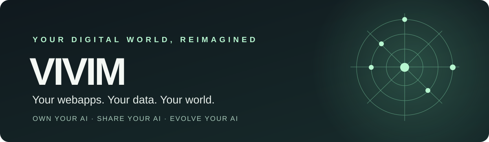

<div align="center">



### Your webapps. Your data. Your AI world.

**Own your AI · Share your AI · Evolve your AI**

VIVIM is building a **local-first personal world for your webapps and AI**. Interact with the services you already use, bring useful information together on your own machine, and organize, search, and reuse it under your direction.

[**The vision**](#the-idea) · [**How it works**](#a-world-you-can-return-to) · [**What's available**](#what-exists-today) · [**Try the preview**](#try-the-developer-preview)


</div>

---

## The idea

**Your data lives across the web. Your personal world shouldn't have to.**

Today your work is scattered across AI chats, documents, dashboards, feeds, and other webapps. Every service has its own interface, history, and context. Finding and connecting what matters means switching between them.

VIVIM is designed around a different starting point: **you, your webapps, and the information you choose to keep locally**.

Its ambition is to **interact with any webapp through a common, user-directed layer**, capture useful content with source context, and bring that information into one locally managed personal world. AI providers are an important first use case, not the limit of the platform. Universal compatibility is a goal, not a claim of verified support for every site.

| **Own your AI** | **Share your AI** | **Evolve your AI** |
| :--- | :--- | :--- |
| Bring selected webapp data, conversations, notes and artifacts into a locally managed world. | Choose which information to export or carry into another website, AI task or workflow. | Organize, annotate, connect and improve your own context over time. |
| **Your knowledge, beyond one provider.** | **Your choice, not automatic exposure.** | **Your work, increasingly useful.** |

> **My machine. My data. My AI.** A product direction built on local-first ownership, user choice and traceable sources — not a promise of absolute security or features that haven't shipped.

## A world you can return to

VIVIM's core experience is one connected journey, not four separate tools.

| Step | What it means for you |
| :--- | :--- |
| **01 · Return** | Open a conversation or piece of work you've actually saved. Read it with its original meaning and context intact. |
| **02 · Organize** | Keep the useful part in your own project, add notes, and relate it to other work. |
| **03 · Find** | Locate the idea, answer or artifact again — without remembering which provider or chat held it. |
| **04 · Take** | Carry selected knowledge into a new task or interaction, deliberately and with context. |

**One personal world. Many webapps. Your data stays under your direction.**

VIVIM Projects are *your* organization layer, not a claim that remote provider Projects have been imported or modified. The provider remains authoritative for its remote account and conversations; VIVIM preserves the local record and user-created context.

### What makes VIVIM different?

- **Webapp-wide ambition.** A reusable browser-based interaction and capture layer aims to work across AI chat, tables, feeds, forms, articles and more — subject to per-site behavior and permissions.
- **Local centralization.** Bring selected records from separate services into one personal data space on your machine, without claiming ownership of remote provider records.
- **Security-conscious control.** Dedicated browser profiles, local-only default server binding, explicit authorization for external actions and clear evidence provenance are part of the current approach. Raw capture still requires care.
- **Persistent by intent.** Saved local material should remain useful even when a provider is disconnected.
- **Source-grounded.** Know what was observed, imported, derived or written by you — including missing or uncertain content.
- **Human-directed.** Reading, selecting, sharing and external actions have distinct boundaries.
- **Provider-independent identity.** Your world is not defined by any single chatbot, browser or model.
- **Built for ownership.** Local storage, selected exports and recovery matter more than keeping everything inside one interface.

## What exists today?

<sup>Public development snapshot · October 2026. Source presence is not the same as a completed live-user acceptance test.</sup>

The code in this repository is the **VIVIM Harness** — the operating foundation for this product. It contains a local Studio UI, a CLI, browser-capture infrastructure and work toward an integrated personal world.

| Capability | Current status |
| :--- | :--- |
| Browser-based webapp observation | **Implemented in source.** Chrome DevTools Protocol capture for authorized tabs, including DOM and network observations; site behavior and coverage vary. |
| Local data centralization | **Foundation present.** Locally stored evidence, derived records, and emerging personal-world views; universal webapp ingestion is not verified. |
| Saved conversations and world views | **Present in source.** Local views for saved material, projects, notes, find, transfer, relations and workspace are under active integration. |
| Native conversation content and provenance | **Partially integrated.** Rich content and source/coverage handling exist; fidelity varies with what was actually observed. |
| Webapp interaction | **Selective capability present.** Explicit browser actions and supported AI-provider flows exist; arbitrary websites do not automatically have working action recipes. |
| Full first-run experience and durable end-to-end user journey | **Still being validated and completed.** This is not yet a polished consumer release. |
| Multi-account support, whole-account history and automatic sync | **Not advertised as available.** Significant decisions and implementation work remain. |

The **vision is broader than the verified product**. We deliberately distinguish a real saved item from a remote reference, a partial capture from a complete conversation, and an implemented endpoint from a tested human journey.

## Try the developer preview

VIVIM is **not yet a one-click consumer download**. If you're comfortable running a local development tool, you can explore the current Harness.

**Prerequisites:** Node.js 22+ and Chrome or a compatible browser for live browser features. Sign in to provider websites yourself. No runtime `npm install` is required.

```sh
git clone https://github.com/owenservera/vivim-harness.git
cd vivim-harness
node bin/studio.mjs start
```

Open the local address reported by Studio. To explore available commands without running the server:

```sh
node bin/studio.mjs help
```

For setup details see the [full technical guide](docs/TECHNICAL-README.md), [live testing instructions](docs/LIVE-TEST.md), and [platform support notes](docs/PORTABILITY.md). A local start does **not** establish that your AI provider is connected or that a particular live workflow succeeds.

## Centralized locally. Managed with care.

VIVIM is designed to **centralize the webapp information you choose on your own machine**, where it can be reviewed, organized and reused with source provenance. The current capture tooling stores evidence locally outside the Git repository and has no product cloud-sync or telemetry service by default. Its Studio server binds to localhost with an optional token access mode, and external browser actions require explicit scope.

**Secure management is a design objective, not a security certification.** Local-first does not mean completely offline, encrypted by default, or isolated from every threat: external webapps still process requests sent to them, and locally stored records need protection.

Raw captures can contain sensitive data, including authentication material observed in browser traffic. Protect local data folders and browser profiles; consider filtered capture when appropriate. Dedicated Chrome profiles are useful separation, **not** operating-system security isolation. VIVIM does not need passwords entered into its own account records.

[Read the local-first boundaries](docs/LOCAL-FIRST.md) · [Read first-user decisions](docs/product/FIRST-USER-ONBOARDING-DECISIONS-2026-10-27.md)

## Explore and follow progress

| Looking for… | Go here |
| :--- | :--- |
| The product direction | [V1 integrated experience blueprint](docs/product/V1-INTEGRATED-APP-BLUEPRINT.md) |
| Technical architecture | [Architecture](ARCHITECTURE.md) |
| Complete command and capture documentation | [Technical README](docs/TECHNICAL-README.md) |
| Latest tasks, bugs and progress | [GitHub issues](https://github.com/owenservera/vivim-harness/issues) |
| Agent and contributor conventions | [AGENTS.md](AGENTS.md) |

**Building in public, with product reality clearly separated from ambition.** Feedback is welcome through [GitHub Issues](https://github.com/owenservera/vivim-harness/issues). Please never include personal chat history, secrets or browser-session data in public reports.

<div align="center">

---

**VIVIM** · Own your AI. Share your AI. Evolve your AI.

[vivim.live](https://vivim.live) · [Source](https://github.com/owenservera/vivim-harness) · [Follow development](https://github.com/owenservera/vivim-harness/issues)

</div>
